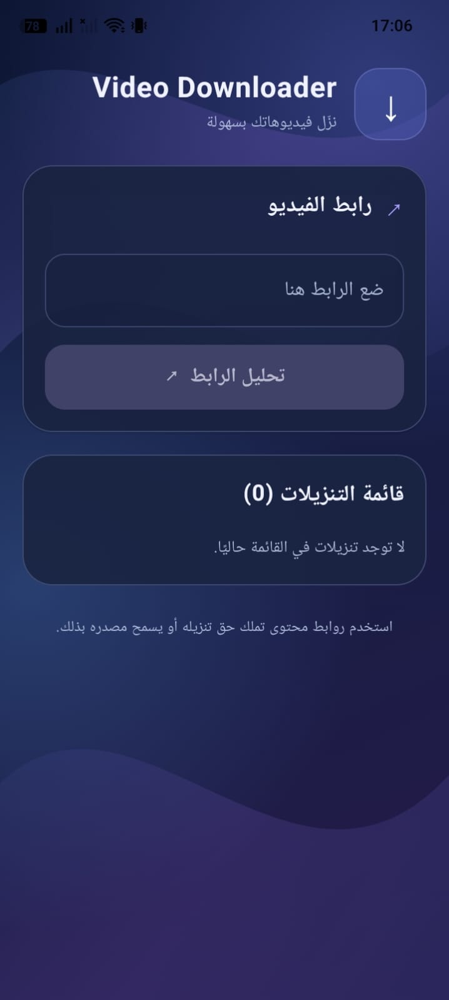
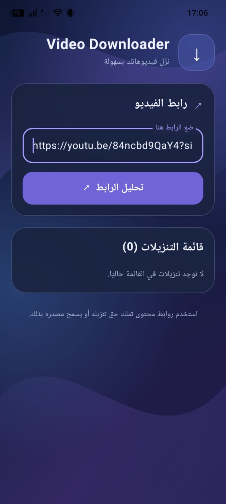
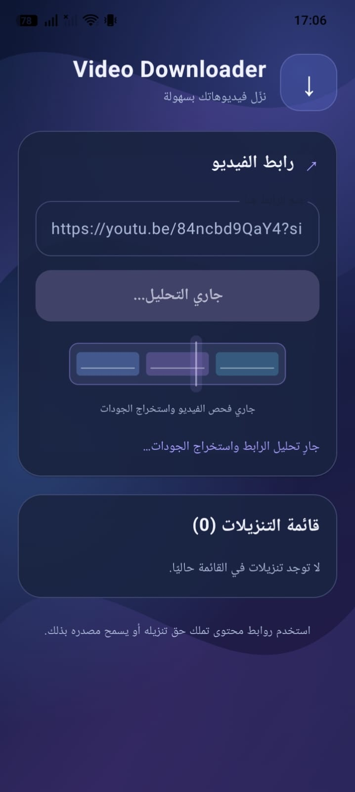
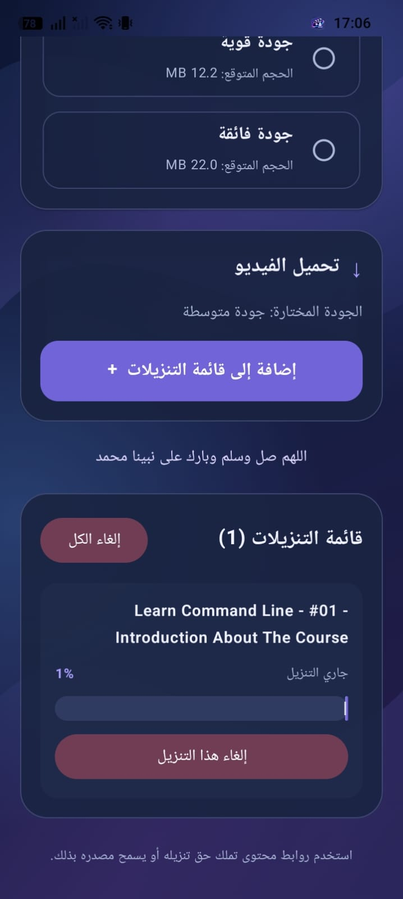

# VideoDownloader

**VideoDownloader** is an Android application designed to download videos from supported platforms directly to your phone.

## Features

- Download videos from supported platforms.
- Choose between four video quality levels.
- Save downloaded videos directly to your device.
- Manage downloads with background support and notifications.
- Estimate complete download routes using measured network and processing performance.
- Clean abandoned temporary workspaces and retain a bounded download history.
- Simple and easy-to-use interface.

## Supported Platforms

- YouTube
- Facebook
- Instagram
- TikTok

## Platform-aware route learning

Version 1.1.0 groups network-performance measurements under these 15 platform identities:

- YouTube
- Facebook
- TikTok
- Instagram
- Snapchat
- X (Twitter)
- LinkedIn
- Telegram
- Reddit
- Pinterest
- Threads
- Twitch
- Vimeo
- Dailymotion
- Likee

These groups are used by the download-time estimator to organize learned network statistics. They are not a guarantee that every URL or platform can be extracted. Actual download support depends on the installed yt-dlp extractors and content accessibility.

## Screenshots

| | |
|:---:|:---:|
|  |  |
|  |  |
|  |  |
|  |  |

## Intended Use

This application is intended for personal, non-commercial use only. Users are responsible for respecting the terms of service and usage policies of each supported platform.

---

**VideoDownloader — Your videos, saved on your device.**
