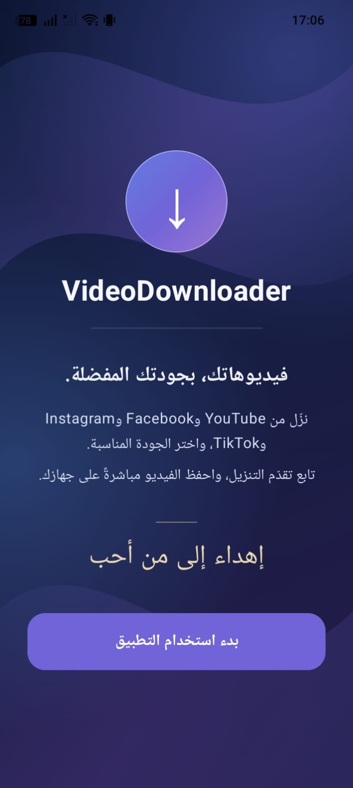
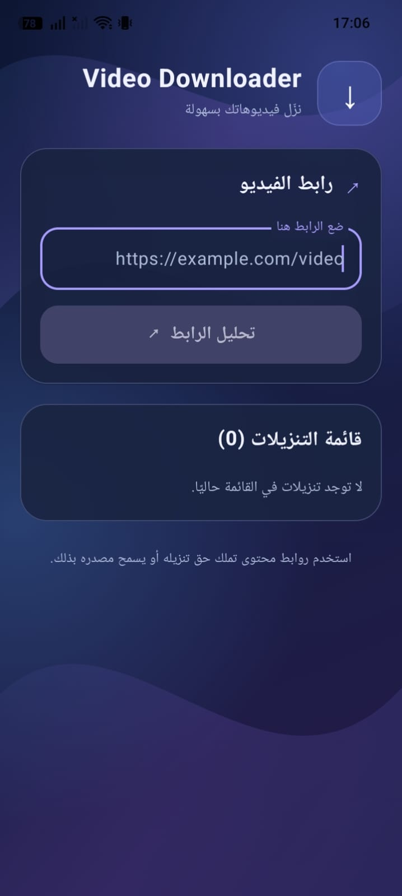
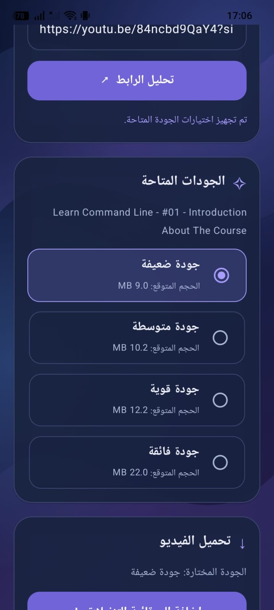

# VideoDownloader

**VideoDownloader** is an Android application designed to download videos from supported platforms directly to your phone.

## Features

- Download videos from supported platforms.
- Choose between four video quality levels.
- Save downloaded videos directly to your device.
- Manage downloads with background support and notifications.
- Simple and easy-to-use interface.

## Supported Platforms

- YouTube
- Facebook
- Instagram
- TikTok

## Screenshots

| | |
|:---:|:---:|
|  |  |
|  |  |
|  |  |
|  |  |

## Intended Use

This application is intended for personal, non-commercial use only. Users are responsible for respecting the terms of service and usage policies of each supported platform.

---

**VideoDownloader — Your videos, saved on your device.**
